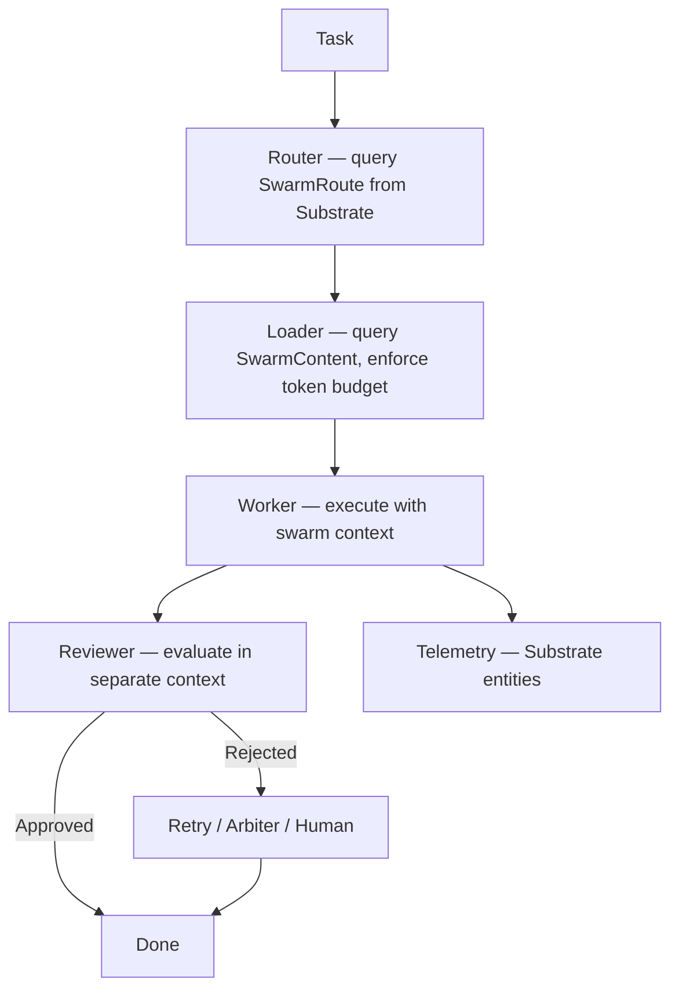

# Swarm

Every AI agent session starts from zero. Context engineering happens per-repo via flat files, and there's no way to validate whether that context actually makes agents better, compare models, or enforce oversight when agents work autonomously.

Swarm fixes this. It's an operating system for AI agents — a shared intelligence layer that routes the right context to every agent session within token budget, validates agent output through a Worker/Reviewer/Arbiter chain, and measures everything with structured telemetry. Model-agnostic, git-native, and testable.

## Install

```bash
curl -fsSL https://mnmal-ai.github.io/swarm/install.sh | bash
```

The installer needs bash, curl, and `sha256sum` or `shasum`: it downloads the binary for your platform from the latest GitHub release and checks it against the release's `.sha256` before installing it to `/usr/local/bin` (`--install-dir <path>` to change). `gh`, logged in (`gh auth login`), is needed only while the repository is private; the installer and `swarm upgrade` fall back to it when github.com refuses an anonymous download.

Initialize swarm in your project:

```bash
swarm init
```

## How It Works

```
Task → classify via Substrate query → load context from Substrate → Worker → Reviewer → Arbiter → Substrate telemetry
```

The router queries `SwarmRoute` entities from Substrate, scores the prompt against keyword lists, picks the best route, loads `SwarmContent` entities, and enforces a per-model token budget. When recall is on, `classifyIntent` and `loadContext` run through the engine's own recall and add embedding similarity to the keyword and path baselines. The oversight chain validates the agent's work in separate context windows: no agent reviews its own output. All telemetry is written as Substrate entities to Postgres.

Two Substrate sidecars run alongside the SDK, one for the cold store (port 32338, Postgres 32337) and one for the meta store (port 32341, Postgres 32340). `swarm run` starts them for you; `swarm substrate start|stop|status` and `swarm doctor` manage and diagnose them. They need Node 26.2 or newer and run from a runtime that swarm installs from npm into `~/.swarm/substrate/runtime`. Swarm content files are the authoring format; Substrate entities are the runtime format. Agents also jot short observations while they work, and a drainstop sweep promotes the high-signal ones into the durable context store. The meta store keeps institutional knowledge across sessions.



The reviewer and the arbiter judge the work against the project's binding rules, `core/rules.md` and `domains/<project>/constraints.md`, given to them in full ahead of everything else, whatever the route or the context budget. Workers already load the same rules.

## Documentation

| Doc | What's In It |
|---|---|
| **[Context Layers](docs/context-layers.md)** | The 7-tier context system, routing, token budgets |
| **[Oversight](docs/oversight.md)** | Agent roles, review policy, trust levels, disagreement handling |
| **[Project Structure](docs/project-structure.md)** | What `swarm init` creates, the `.swarm/` directory |
| **[SDK API](docs/sdk-api.md)** | TypeScript API — Swarm class, oversight, benchmarking, multi-task workflows |

## CLI

```bash
swarm init                    # Scaffold a swarm for your project
swarm run --project my-app    # Execute goals with the orchestrator
swarm run --dashboard-lan     # With live dashboard accessible on LAN
swarm skill                   # Manage skill files
swarm mcp                     # MCP server operations
swarm substrate start|stop|status  # Manage the Substrate sidecars
swarm doctor                  # Diagnose the Substrate stack
swarm upgrade                 # Upgrade to latest version
swarm uninstall               # Remove swarm from project
swarm uninstall --global      # Stop the sidecars, remove the installed swarm binary
swarm --help                  # All commands and options
```

## Token Budgets

`swarm run` budgets in tokens, never dollars: a session, each goal and each task have a token limit, counting all input (fresh, cache reads, cache writes) plus output. Set them in the project's `config.json` under `concurrency`, or leave them out to take the trust level's defaults (medium: 6M per task, 20M per goal, 60M per session). Dollar keys from older configs stop the run at startup with the replacement named:

| Old key | New key |
|---|---|
| `max_cost_per_session` | `max_tokens_per_session` |
| `max_cost_per_goal` | `max_tokens_per_goal` |
| `max_cost_per_task` | `max_tokens_per_task` |

See [Project Structure](docs/project-structure.md) for the defaults per trust level.

## GitHub Access

On a machine with several `gh` logins, swarm would otherwise act as whichever account is active. Name the account per project in `config.json`:

```json
"source_control": {
  "strategy": "remote_pr",
  "stack_prs": true,
  "github_account": "example-bot"
}
```

With `github_account` set, `swarm run` takes that account's token from gh once at start (`gh auth token --user example-bot`) and, before any work, checks that the token belongs to the account (`gh api user`) and that the account can see the repository the work repo's remote names (`gh api repos/<owner>/<repo>`; SSH aliases like `git@work-alias:owner/repo.git` are understood). A failed check stops the run with the fix named. If `source_control.git_identity.email` is a GitHub noreply address of another account, swarm warns. The token stays in memory and goes only to swarm's own GitHub operations — `gh pr create`, the GitHub Issues task backend, and `git push` to an HTTPS GitHub remote (SSH remotes are pushed as before). It is never logged or written to config, telemetry or the Substrate store. Without the setting, gh's active account is used as before.

The preflight banner shows the account either way: `GitHub  example-bot ✓ example-org/sample-app`, or gh's active account, or `not logged in`.

**Workers get no GitHub access.** Worker, reviewer and arbiter processes receive none of `GH_TOKEN`, `GITHUB_TOKEN`, `GH_ENTERPRISE_TOKEN`, `GITHUB_ENTERPRISE_TOKEN`, and `GH_CONFIG_DIR` points at an empty per-run directory, so `gh` inside a worker has no login and cannot fall back to the machine's. PRs are opened by swarm (`remote_pr`), not by workers, so `stack_prs: true` requires `strategy: "remote_pr"`: with any other strategy (or none), `swarm run` refuses to start and says to set `remote_pr` or turn `stack_prs` off, rather than finish with no PR. This removes ambient access; it is not a sandbox, and denied-command lists remain a second layer.

**External tools.** `packages/cli/src/external-deps.ts` declares the tools swarm runs but does not ship, the major version each is tested with, and the behaviours swarm relies on: gh (tested with 2.x) and fnl (0.x). When a run will use one and the installed major differs, swarm warns that behaviour may be unpredictable, naming both versions.

## Merge As You Go

By default a multi-goal run ends with open pull requests: one per goal, or a stack with `stack_prs`. With `merge_prs`, swarm merges each goal's pull request as soon as the goal is done, and the next goal starts from the updated base branch, so nothing stacks:

```json
"source_control": {
  "strategy": "remote_pr",
  "github_account": "example-bot",
  "merge_prs": {
    "enabled": true,
    "gate": { "command": "make test", "cwd": ".", "env": { "CI": "1" }, "timeout_ms": 3600000 },
    "skip_labels": ["swarm_merge: false"],
    "after_merge": "done"
  }
}
```

For each goal that completes, swarm:

1. pushes the goal's branch and opens its pull request against `base_branch`, or reuses the open one a previous attempt left;
2. checks that the goal may merge: every task's final review verdict is `approved`, `completed_with_notes` or `completed_with_deferrals` (none failed, rejected or skipped), and the goal's source item carries none of `skip_labels`;
3. merges the latest `base_branch` from the remote into the goal branch (a merge commit, as `git_identity` when set; never a rebase or force-push);
4. runs the merge gate (`sh -c`, in the work repo or `gate.cwd` inside it) on the branch as it would land. The gate runs code the agents wrote, so it inherits only a short allowlist of swarm's environment (`PATH`, `HOME`, locale and toolchain locations such as `JAVA_HOME`), plus `gate.env`, with `gh` pointed at an empty config: no provider API keys and no GitHub tokens. Its output is redacted for common secret shapes before it reaches the run log. The gate keeps the machine's `HOME` (and `DOCKER_HOST`), because builds need their caches and containers, so it trusts the same home directory as the workers that wrote the code; run swarm under an account whose home holds nothing the gate must not read. The gate runs in its own process group, and a timeout kills the whole group;
5. pushes, merges the pull request with `gh pr merge --merge --match-head-commit <the gated commit>` as `github_account`, so nothing pushed after the gate can land ungated, and then asks GitHub whether it merged (a merge call that errors after merging is still reported as merged, and an unreadable answer is reported as unknown, never as a refusal);
6. puts the work repo back on `base_branch` at the remote.

A goal that is not eligible, conflicts with the base, fails or times out the gate, or that GitHub will not merge keeps its pull request open, with a comment on the pull request and on the source item saying why (swarm's own text; the gate's output stays in the run log). The run goes on to the next goal from the base branch. A goal that does not complete gets no pull request, as before.

| Key | Default | Meaning |
|---|---|---|
| `enabled` | `false` | Turn merge-as-you-go on |
| `gate.command` | (required) | The command that must pass before a merge |
| `gate.cwd` | the repo root | Where the gate runs, relative to the repo root |
| `gate.env` | none | Extra environment for the gate |
| `gate.timeout_ms` | `3600000` | Kill the gate after this long; a timeout is a failed gate |
| `skip_labels` | `["swarm_merge: false"]` | Source labels that leave the pull request for a person; matched ignoring case and spaces around a colon |
| `after_merge` | `"done"` | `"done"` moves the source item to its merged status (Trello: the `lists.merged` column, default `Done`; GitHub issues: closed). `"review"` leaves it where the pull request put it, for boards where a deploy follows the merge |
| `max_rounds` | 3 | Rounds of bringing the base in, gating, checking the base and merging before swarm leaves the PR open because the base kept moving |
| `resolve_conflicts` | true | Hand a conflict with the base back to a worker (then the reviewer) instead of leaving the PR open |
| `max_conflict_rounds` | 2 | How many conflict hand-backs one merge may make |

`merge_prs` requires `strategy: "remote_pr"`, a `github_account` and a `gate`, refuses `auto_push` or `pr_on_goal_complete` set to `false`, and refuses to start together with `stack_prs`: merging each goal and stacking goals on each other are two different plans for the same branches. Unknown keys under `merge_prs` and `merge_prs.gate` refuse to start. Merging never deploys anything.

**One merge at a time per repository.** Every swarm process on this machine that merges into the same repository and base takes turns, first come first served, whichever project or clone it runs from. Waiting runs say who holds the turn; a run that died or stopped answering for two minutes loses it. The lock lives in `~/.swarm/merge/`.

**What merges is what was gated.** Before merging, swarm checks that the base has not moved since it merged it into the branch for the gate. If it moved, or GitHub refuses because it did, swarm merges the new base in and gates again (up to `max_rounds`). A base swarm cannot read is never taken as unmoved: the pull request is left open. A refusal that finds the base where the gate saw it (branch protection, required reviews) leaves the pull request open as refused, without gating again.

**Pull requests left open.** A conflict, a base that kept moving, or a refusal is tried again by later runs, at most three attempts in all, or with `swarm merge` whenever you ask. A failed gate is tried again only on request: `swarm merge --all`, or `swarm merge --pr <url>` for one. A retry first asks what became of the pull request: one a person merged is recorded as merged, one a person closed stays closed (closing it is how to stop swarm retrying), and a branch someone pushed to after the gate is left to them. Swarm comments when it leaves a pull request open, and not again for the same reason. A conflict a worker resolved counts only if the worker committed everything and stayed on the branch. `swarm merge` and `swarm run` refuse to run for the same project at once: they share its work repo and checkpoint.

**Code hosts.** Swarm opens and merges pull requests through a `CodeHost` (`source_control.code_host`, default and so far only `"github"`). Supporting GitLab, Gitea or Bitbucket means one more implementation of that interface; `packages/orchestrator/src/source-control/code-host.ts` says how.

## Stopping and Resuming

**Goals finished in an earlier run still get published.** Under `stack_prs` or `merge_prs`, the checkpoint (`<domain>/.checkpoints/checkpoint.json`) records, for every goal that completes, its branch and whether that branch was pushed, its pull request's URL, and whether it was merged (`goal_publications`), updated as each step happens. The next run (which resumes the checkpoint by default) publishes what is left, without the goal being in its goal list:

- `stack_prs`: the unpublished goals go at the front of this run's stack, in the order they finished, each PR against the branch the goal was built on, and this run's goals build on top of them.
- `merge_prs`: each unpublished goal gets its push, pull request and, by the rules above (verdicts, skip labels, gate), its merge, before this run's first goal; or, when the last run stopped in the middle of a goal, right after that goal.

A goal whose pull request was opened, merged, or deliberately left open is not touched again. The stacked push no longer checks anything out, so a working tree a failed task left dirty cannot keep finished goals from being pushed.

**An expired Claude login stops the run.** When a session fails because the agent runtime's login is gone (an OAuth session that expired or could not be refreshed, a 401, "please run /login"), swarm does not fail the task or the goals after it. It stops dispatching, marks nothing failed and moves no source item to Blocked (the in-flight goal's item goes back to the queue it came from), saves the checkpoint, emits `run:login_expired`, prints ``Claude login expired: run `claude` and `/login`, then re-run to resume``, and exits non-zero. Finished goals are still published. A plain re-run after logging in starts with the goal it stopped in. Swarm never retries the session, and never falls back to another backend or an API key because of it.

## Left for a Person

A reviewer can pass a task with items only a person can do (an on-device check, a credential the agent cannot have, a judgment call): `completed_with_deferrals`. The reviewer lists them in its verdict's `deferred` field (and accepted deviations in `notes`); for a reviewer that only says so in its reasons, swarm picks out the sentences saying "Deferred to a person", "HUMAN-DEFERRED" or "needs a person". Swarm lists the items, grouped by task and without repeats, under **Left for a person** in the goal's pull request, in a comment on its source item, on the task's dashboard card, and as counts per goal in the end-of-run summary.

## Build Output (fnl)

Build, test and lint logs are the largest thing an agent reads, and every later call re-reads them. [fnl](https://github.com/mnmal-ai/fnl) runs such a command and hands back a short digest (errors with file and line, failing tests with their messages, counts) while keeping the full output one `fnl show <id>` away. Turn it on per project in `config.json`:

```json
"fnl": {
  "enabled": true,
  "wrap": ["make build", "./gradlew *"]
}
```

- `enabled` (default `false`) turns it on. `bin` names the fnl to use: a path (absolute, or relative to where `swarm run` starts) or a command name looked up on PATH (default `fnl`). swarm runs it (`--help`) when it starts, so `bin` is trusted like the rest of `config.json`. `wrap` lists extra commands to digest, as fnl wrap patterns, on top of the tools fnl's adapters recognise.
- At start, `swarm run` checks that the fnl it finds supports `rewrite --deny` and `--check-invokes-fnl`. If fnl is missing or too old, it prints one warning and agents run commands as written.
- Each such session's system prompt also asks the agent to run each build, test or lint command as its own Bash call, with environment variables on the command rather than in a separate `export`. fnl leaves a command chained with `;` or `&&`, or piped into `grep` or `head`, as written, and agents otherwise tend to write exactly that.
- Each Claude Code session with the Bash tool gets a PreToolUse hook. It asks `fnl rewrite` whether to wrap the command, passing the session's Bash deny rules (`--deny`) so a denied command is never rewritten and is still refused, and returns the rewritten command with no permission decision, so normal permission checks still apply. A command that calls fnl itself is denied, because `fnl run -- '…'` would hide the inner command from prefix deny rules. If fnl fails or takes more than 3 seconds, the command runs unchanged. The rewritten command calls fnl by the absolute path swarm found (`'/path/to/fnl' run -- '…'`), so it works whatever the agent shell's PATH holds; an allow rule written as `Bash(fnl run:*)` won't match it, and swarm's usual approval of commands that no rule denies applies.
- **Coverage is counted.** When the fnl found explains each decision (`fnl rewrite --json`), every session counts its build and test commands: how many fnl wrapped, and fnl's reason for each one it left as written (`structure` means other shell around the command, `deny-rule` a deny rule matched it). No command text is kept, only tool names and reasons. A worker's counts end its `session done` line, a reviewer's or arbiter's get their own `[fnl]` line, the run summary adds them up, and the live dashboard has an **fnl** tile with the run's total and each session's line in the event log:

  ```
  [14:02:11] session done: 1 turns, 412.0k tokens · fnl: wrapped 1 of 3 build/test commands (2 left alone: structure)
    fnl coverage:    wrapped 4 of 6 build/test commands (2 left alone: structure)
  ```

  The counts are also stored on the session's `SessionEvent` (`fnlCoverage`, JSON). An fnl that can't explain its decisions still works; swarm warns once at start that coverage isn't counted (`fnl upgrade` fixes that).
- **Savings are measured.** In the same sessions, PostToolUse and PostToolUseFailure hooks measure each wrapped call once it has run, failed ones included: the characters the agent was sent (the digest, or a failed call's error text), fnl's full output for the run (`fnl show <id>`, the id read from the digest's footer), and what the agent's own command would have shown without fnl: that output through the command's own `| tail`, as Claude Code hands a result to the model. A successful result is sent whole up to Claude Code's Bash output limit (30,000 characters, or the session's `BASH_MAX_OUTPUT_LENGTH`); over it, the model gets a 2,000-character preview and the path of a file holding the rest. A failed command's text keeps its first and last 5,000 characters past 10,000. The saving is the difference, never below zero, in tokens estimated as characters / 4. It is a first-read saving: a tool result stays in the conversation and is re-sent on every later call, so the context saved over a session is larger. For a large log, one over those limits (`oversized`), the bigger benefit is not the tokens: without fnl the agent would have seen only part of the log and needed more reads to find the failure, and with fnl the result is in the digest. A call that can't be measured (no footer in the result, `fnl show` failing, or the call interrupted) is counted as unmeasured. The totals ride in `fnlCoverage` as `savings`, and end the fnl clause of the `session done` line (`· saved ~12k tokens · 3 large logs digested`), the run summary (`· saved ~1.2M tokens of output (first read) · 6 large logs digested`) and the dashboard's **fnl** tile.

## Context by Section

Swarm context can load by section instead of by whole file. Turn it on per project in `config.json`:

```json
"context": {
  "sections": { "enabled": true, "paths": ["docs/"] }
}
```

- Before each task, swarm stores its `.swarm/` markdown and the markdown under `paths` in the task's checkout as sections in the project's Substrate store (`swarm-docs` namespace), split at level-2 headings (level 3 inside long sections). Unchanged files are skipped.
- Each section gets a one-line synopsis written by a small model, one call per changed file, through the same Claude subscription the workers use. A `<!-- synopsis: … -->` line under a heading overrides it; if the call fails, the first sentence is used.
- Synopses for several changed files are written at once: 4 by default, set with `"concurrency"` (1 to 8) in `sections`. A large file is described in batches of about 48 KB of text (at most 40 sections) per call, so no single call runs long enough to be cut off; a batch that still fails falls back to first sentences on its own, and the end-of-sync line counts them (`· 12 sections fell back to first sentences`). The first sync of a project writes every file and can take a few minutes; later ones skip what hasn't changed.
- The live dashboard's header says what swarm is doing now and for how long: `Planning <goal>`, `Working on: <task>`, `Reviewing: <task>`, `Between tasks`, with `— preparing context: synopses 24/34 · 70% · about 8 min left` while a sync runs. A page opened part way through picks it up from the server.
- The run log says what the sync is doing: `context: writing synopses for 34 changed files, 3.2 MB of text (a first sync can take a few minutes)`, then `context: synopses 24/34 files · 70% of text · about 8 min left at 128 KB/min` every few files or 15 seconds, then `context: synopses written for 34 files, 3.2 MB of text, in 25m 3s at 131 KB/min` (or `context: sections up to date`). Progress is weighed by text, since files run from 1 KB to hundreds, and the time left comes only from throughput measured so far over wall-clock time: swarm says `estimating…` until two files or 30 seconds are done. The same numbers, and nothing but numbers, go to the live dashboard as `context:sync-*` events.
- The route's swarm files then fill the budget section by section, and each section left out shows in the session's context record as `path › Heading`. Files without stored sections load whole, and a failed sync never stops a task.

### Reading documents by section

With sections on, agents can also be given an index of the stored documents and read only the sections they need (stage 2). It needs `sections`; `pull` on its own is a config error:

```json
"context": {
  "sections": { "enabled": true },
  "pull": { "enabled": true, "maxReadTokens": 4000 }
}
```

- `enabled` turns it on (default off). `maxReadTokens` (500 to 100000, default 4000) is the most a read may take when it spans more than one section.
- The worker's context ends with a `## Documents` block, in a quarter of the context budget: one line per section, `- L41–120 Errors › Retries (900 tok) — How clients retry.`, under each document. Documents the task names come first, then swarm files the budget cut; the rest fold to one line each (`- docs/guide.md (31,200 tok, 42 sections) — Contributor guide`). `L41–120` means `Read` with offset 41 and limit 80, so agents read a section from the file itself, as it is now.
- A `Read`, or a Bash `cat`, `less`, `head`, `tail` or `sed -n`, that spans several sections of an indexed document and more than `maxReadTokens` is refused, with the document's sections and line ranges as the reason. One section is always allowed, however big. A document edited since the sync is outlined from its headings as they are now. Anything the guard can't work out runs as written.
- Reviewers get the same index, headed by the sections the worker read, and the same guard.
- The run log's `session done` line adds `· docs: 5 section reads, 1 refused` (and `, 2 whole` for small documents read whole), and the session's context record keeps the index's size and the ranges read.

A project's rules can be delivered the same way once they outgrow a budget. It needs neither `sections` nor `pull`:

```json
"context": {
  "rules": { "enabled": true, "maxTokens": 2000, "relevant": 3, "paths": ["domains/acme/conventions.md"] }
}
```

- The rule files are `core/rules.md`, the project's `constraints.md`, and any swarm-relative `paths`. A rule is a section under a heading at levels 2 to 4.
- A comment on the line after a heading marks its rule: `<!-- rule: must -->`, `<!-- rule: should -->` or `<!-- rule: should, pinned -->`. A subsection takes its parent's marker, and `<!-- rules: should -->` before the first heading sets a file's default. Unmarked rules are `must`, so an unmarked file arrives in full as before.
- While every rule fits `maxTokens` (200 to 100000, default 2000), nothing changes. Over it, a session on a direct-execution backend gets a `## Project Rules` block in place of the rule files:
  - `must` and pinned rules in full;
  - the `relevant` (0 to 20, default 3) `should` rules that best match the task in full, while the block fits;
  - every other rule as one line, `- L41–58 Database › Retries (180 tok) — …`, read with `Read` and that range.
- Reviewers and arbiters on a backend get the same block. Sessions on the API loop get the rules in full.
- Rules come from the store. A file is listed by line range only while its copy in the swarm folder matches the stored one; otherwise its rules go in full.
- With `pull` on, a rule file with index lines joins the read guard. The session's context record keeps `rules: { sections, full, indexed, tokens, tokensIfFull }`.

### Ranking sections by relevance

With sections on, swarm can rank each task's sections by similarity to the task and add the best-ranked ones the route didn't load (stage 3). It uses an embedding model on this machine's Ollama, so no document text leaves it:

```json
"context": {
  "sections": { "enabled": true },
  "pull": { "enabled": true },
  "ranking": { "enabled": true }
}
```

- Set in the project's domain config (`.swarm/domains/<project>/config.json`), where `swarm run` reads `context`. Settings, all optional: `model` (default `bge-m3`), `dimension` (its vector size; swarm knows bge-m3's 1024, nomic-embed-text's 768 and a few more), `ollamaUrl` (default `http://127.0.0.1:11434`), `maxSections` (the most ranked sections added per task, 1 to 40, default 5; the rest stay index lines, best first), `timeoutMs` (how long one embed may take, 1000 to 120000, default 15000). A project with `substrate.local_only` refuses an Ollama that isn't on this machine.
- Pull the model first (`ollama pull bge-m3`), then restart the project's sidecar (`swarm substrate stop`, then `swarm substrate start`). Substrate's recall plugin owns the embeddings. A change of dimension requires clearing the stored rows and calling `POST /substrate/v1/embed/reindex`.
- Each section embeds its heading path, its synopsis and the first 2,000 characters of its body, about 500 tokens, under the 2,048 tokens Ollama embeds by default.
- After the route's files load, the project's sections most similar to the task (up to `maxSections`) are added in rank order while they fit, leaving the index its quarter of the budget, and stopping at the first that doesn't fit. Each arrives as its own block, `--- swarm: docs/guide.md › Deploys (ranked) ---`. In the index, ranked sections carry their place: documents expand by their best-ranked section after the ones the task names, so the lowest-ranked fold first.
- Ranking takes the place of whole-file recall for swarm files, which now arrive as their relevant sections.
- If Ollama is down, or nothing is embedded yet, the context is what it would be without ranking, and the session's context record says why (`ranking: unavailable` or `no-embeddings`). With ranking on, the record shows `ranked`, how many sections were candidates, and how many were added at what cost.

## Goal Badges

The live dashboard names each goal on its badges (on the goal's card, on its task cards, and in the header's `Planning …` and `Finished …` lines) by the ticket's id as its URL shows it:

| Ticket URL | Badge |
|---|---|
| `https://trello.com/c/aB3dE5fG/12-add-export` | `aB3dE5fG ↗` |
| `https://github.com/acme/app/issues/42` | `#42 ↗` |
| `https://example.atlassian.net/browse/APP-123` | `APP-123 ↗` |

A goal with no ticket URL keeps showing its goal id, unless its entry in `goals.json` sets a `label` (one line, at most 32 characters). Hovering a badge shows the full goal id and the ticket's title, and a badge with a ticket still links to it.

To have a model pick a short, readable name from each ticket's title instead, name one on the task source in `config.json`:

```json
"taskBackendConfig": {
  "type": "github",
  "labels": { "model": "claude-haiku-4-5-20251001" }
}
```

- `model` is the only setting, and it has no default: without it, no model is called.
- **Cost: one small call per new card**, and again when a card's title changes, through the Claude subscription the workers use. The call has no tools, settings or API key, and the model sees only the ticket's title and the source's name. Labels are cached in `domains/<project>/goal-labels.json`, keyed by source, goal id and title, so a ticket keeps its label from run to run.
- A label is one line of at most 16 characters, with quotes and markdown stripped. A call that fails, times out or gives nothing usable keeps the URL id and is tried again next run. Swarm makes four calls at a time, waits at most 30 seconds for labels in all, and logs one line: `labels: 3 picked by claude-haiku-4-5-20251001, 12 from cache, 0 kept the ticket id`.

## Monorepo Packages

| Package | Description |
|---|---|
| `@mnmal-ai/swarm-core` | Swarm class, Router, Loader, Executor |
| `@mnmal-ai/swarm-oversight` | Worker/Reviewer/Arbiter chain |
| `@mnmal-ai/swarm-orchestrator` | Multi-goal DAG scheduling, replanning |
| `@mnmal-ai/swarm-worker-backends` | API and Claude Code backends |
| `@mnmal-ai/swarm-telemetry` | Substrate telemetry entities, secret scrubbing |
| `@mnmal-ai/swarm-cli` | `swarm` CLI entry point |
| `@mnmal-ai/swarm-types` | Shared TypeScript interfaces |
| `@mnmal-ai/swarm-events` | Typed event bus |
| `@mnmal-ai/swarm-benchmark` | Behavioral test runner |
| `@mnmal-ai/swarm-task-backends` | Local JSON, GitHub Issues and Trello backends |
| `@mnmal-ai/swarm-substrate` | Substrate HTTP client, sidecar lifecycle |
| `@mnmal-ai/swarm-substrate-plugin` | The `swarm` coordinator plugin (types, resolvers) |
| `@mnmal-ai/swarm-substrate-shared` | Constants and types shared by the client and the plugin |

## Development

```bash
pnpm install          # Install dependencies
pnpm turbo build      # Build all packages
pnpm turbo test       # Run tests
pnpm turbo lint       # Lint
```

## Repository

This is **[mnmal-ai/swarm](https://github.com/mnmal-ai/swarm)** — the CLI, SDK, orchestrator, and oversight chain. Swarm content files are bundled in this repo and seeded into Substrate at runtime.

## License

Apache-2.0. See [LICENSE](LICENSE).
