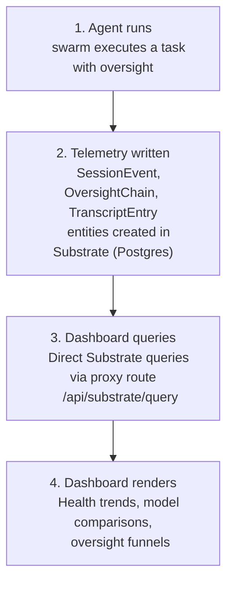

# Swarm Dashboard

A React SPA for visualizing [Swarm](https://github.com/mnmal-ai/swarm) system telemetry. Monitors agent health, compares model performance, and tracks oversight resolution.

## Telemetry Pipeline

Data flows from agent execution to this dashboard through Substrate:



The swarm also ships an embedded live dashboard at `localhost:3141` for real-time monitoring during active sessions. The live dashboard now includes a Substrate Store panel (entity counts, timing breakdown). This dashboard is the complementary post-mortem analytics view for historical trends and cross-session analysis.

## Tabs

**Health** — First-pass acceptance rate, arbiter rate, escalation rate, weekly trends, and per-mode performance breakdown.

**Models** — Side-by-side comparison of different models running the same swarm version. Shows first-pass rate, arbiter %, escalation %, average tokens, and latency.

**Oversight** — Resolution funnel showing how sessions flow through worker → reviewer → arbiter → human escalation.

## Key Metrics

| Metric | Target | Alert Threshold | Severity |
|---|---|---|---|
| First-pass acceptance rate | ≥ 85% | < 80% rolling 7 days | High |
| Arbiter involvement rate | ≤ 10% | > 15% rolling 7 days | Medium |
| Human escalation rate | ≤ 5% | > 10% rolling 7 days | High |
| Context budget overflow | ≤ 5% | > 15% | Medium |

## Quick Start

```bash
npm install
npm run dev
```

Open [http://localhost:5173](http://localhost:5173). The dashboard loads with sample data.

## Data Source

Currently uses sample data in `src/data/sample-data.js`. In production:

1. The [swarm](https://github.com/mnmal-ai/swarm) writes telemetry as Substrate entities (`SessionEvent`, `OversightChain`, `TranscriptEntry`) to Postgres.
2. The dashboard reads telemetry from Substrate via a proxy route (`/api/substrate/query`) — no aggregation step needed.
3. For offline/demo use, the dashboard falls back to summary JSON files from `public/data/`.

The `SAMPLE_DATA` shape in `src/data/sample-data.js` is the contract — production query results must match this shape exactly.

## Development

```bash
npm run dev       # Dev server with HMR
npm run build     # Production build to dist/
npm run preview   # Preview production build
```

The run list and run detail views read the telemetry API at `VITE_TELEMETRY_ENDPOINT` when a build sets it, else at the placeholder in `src/telemetry-endpoint.js` (which mirrors `DEFAULT_TELEMETRY_ENDPOINT` in `packages/telemetry`).

## Where It Lives

The dashboard is the `dashboard/` directory of the [swarm](https://github.com/mnmal-ai/swarm) repository, a separate npm project beside the pnpm packages. The SDK in that repository emits the telemetry the dashboard visualizes.

## License

Apache License 2.0, as for the rest of the repository; see [`LICENSE`](../LICENSE).
