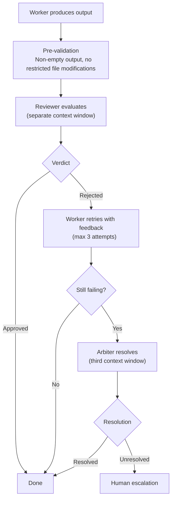

# Oversight

Swarm uses a multi-agent oversight chain where separate agents validate each other's work. No agent reviews its own output — the reviewer and arbiter operate in their own context windows.

## Agent Roles

| Role | What It Does | Default Model | What It Loads |
|---|---|---|---|
| **Orchestrator** | Plans and dispatches tasks toward goals. Does not execute. | `claude-opus-4-6` | Core + orchestration mode + domain overview |
| **Worker** | Executes tasks (writes code, investigates bugs). | `claude-opus-4-6` | Full swarm context via router |
| **Reviewer** | Evaluates Worker output against swarm expectations. | `claude-sonnet-4-6` | Swarm context + behavioral test cases for the mode |
| **Arbiter** | Resolves Worker/Reviewer disagreements. | `claude-opus-4-6` | Both outputs + review policy |

Models are overridable per project in `domains/<project>/config.json`.

Workers **cannot modify** swarm files, tests, oversight policy, or telemetry schemas. This is enforced by instruction and infrastructure.

## The Chain

## Review Policy

Defined in `oversight/review-policy.json`.

**Always reviewed** (regardless of trust level):
- Production config changes
- Database migrations
- Security-related code
- CI/CD pipeline changes
- Dependency additions or upgrades

**Conditionally reviewed** (medium/high trust projects):
- Changes touching > 5 files or > 200 lines

**Skipped** (high trust projects only):
- Documentation-only changes
- Comment additions
- Test-only changes with no production code

## What the Reviewer Leaves for a Person

Besides `verdict` and `reasons`, the reviewer's JSON carries `deferred` (one line per item it passed the task with but left for a person: what remains and why only a person can do it) and `notes` (one line per documented deviation it accepted). A reviewer that only writes deferrals into its reasons is still heard: swarm picks out sentences saying "Deferred to a person", "HUMAN-DEFERRED" or "needs a person", skipping ones that say nothing was. The items travel on `OversightResult` and the `task:verdict` event, and `swarm run` lists them under **Left for a person** in the goal's pull request, on its source item, on the dashboard and in the run summary. An arbiter sign-off keeps them; an arbiter overturn drops them.

## Disagreement Handling

| Severity | Examples | Action |
|---|---|---|
| Minor | Style, naming | Auto-retry with feedback (max 2 attempts) |
| Moderate | Logic concerns, missing tests | Arbiter review (1 attempt) |
| Severe | Security issues, restricted access | Immediate human escalation |

## Trust Levels

Each project declares a trust level in its `config.json`. Trust determines concurrency, review requirements, and worker count.

| Trust | Max Workers | Token limits (task / goal / session) | Review Policy | Use Case |
|---|---|---|---|---|
| **Low** | 1 | 3M / 12M / 20M | Always reviewed | New projects, untested domains |
| **Medium** | 3 | 6M / 20M / 60M | Conditionally reviewed | Established projects with domain docs |
| **High** | 5 | 12M / 40M / 120M | Skip review for low-risk changes | Mature projects with comprehensive tests |

Token limits count all input (cache reads and writes included) plus output; `config.json` can override each one — see [Project Structure](project-structure.md).

Trust also sets `autonomy.escalation.decompose_on_failure` — off for low, on for medium and high — which decides whether a task that times out or escalates may be split into sub-tasks. How much swarm splits work is set by `decomposition` in `config.json`; see [Project Structure](project-structure.md).

## Healthy Ratios

| Metric | Target | Alert If |
|---|---|---|
| First-pass acceptance rate | ≥ 85% | < 80% rolling 7 days |
| Arbiter involvement rate | ≤ 10% | > 15% rolling 7 days |
| Human escalation rate | ≤ 5% | > 10% rolling 7 days |

If arbiter rate climbs, swarm files are ambiguous. If everything degrades at once after a model change, benchmarking should have caught it.
